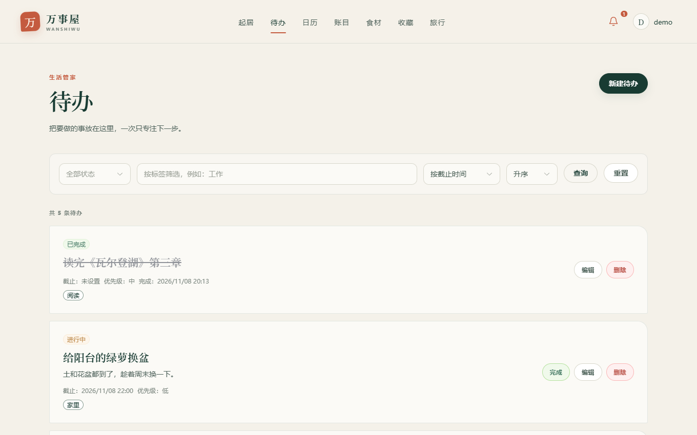
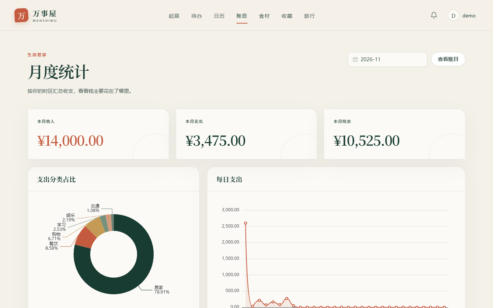
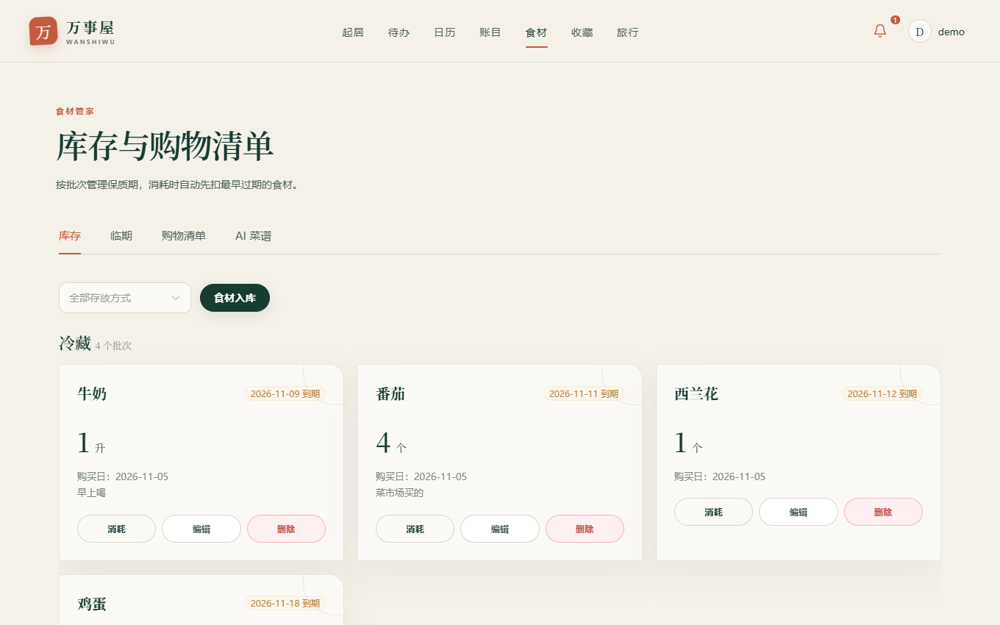
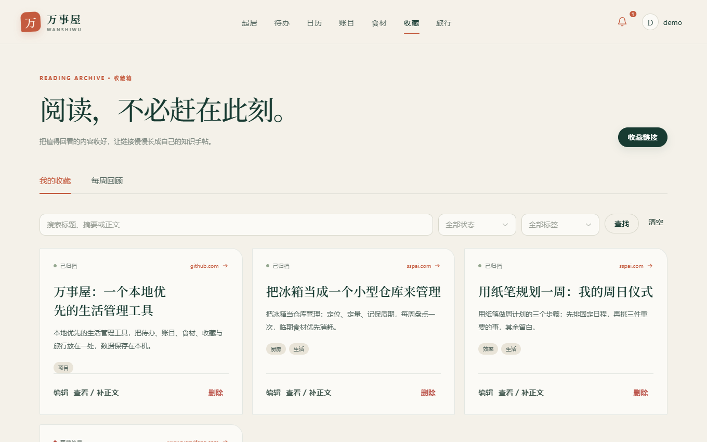

# 万事屋 WanShiWu

> 把待办、食材、收藏和旅行，收进一间安静的小屋。

万事屋是一款本地优先的个人生活管理软件，包含生活管家、食材管家、收藏箱和旅行规划四个模块。既可以直接安装 Windows 桌面版，也保留完整的 Web 开发与自托管能力。Android 与微信小程序端计划单独开源，暂不包含在本仓库。

**核心理念：AI 提议，人确认。** AI 负责理解自然语言和生成建议，真正的数据写入由可校验、可追踪的业务代码完成。

<p>
  <a href="https://github.com/PeterWilsono/WanShiWu/releases/latest"></a>
  <a href="https://github.com/PeterWilsono/WanShiWu/actions/workflows/ci.yml"></a>
  <a href="./LICENSE"></a>
  
</p>

## 界面预览

<p align="center">
  
</p>

<table>
  <tr>
    <td width="50%" valign="top">
      <br>
      <sub><b>生活管家</b> · 待办、优先级与截止时间，完成后仍可找回</sub>
    </td>
    <td width="50%" valign="top">
      <br>
      <sub><b>账目</b> · 按月汇总收支、分类占比与每日支出趋势</sub>
    </td>
  </tr>
  <tr>
    <td width="50%" valign="top">
      <br>
      <sub><b>食材管家</b> · 按批次管理库存与保质期，消耗时先扣临期</sub>
    </td>
    <td width="50%" valign="top">
      <br>
      <sub><b>收藏箱</b> · 标签、摘要与全文搜索，值得回看的内容留在一处</sub>
    </td>
  </tr>
</table>

<p align="center">
  <br>
  <sub><b>统一 AI 入口</b> · 一句话说清楚，AI 拆成草稿，确认后才写入</sub>
</p>

<sub>以上截图使用演示数据，界面以实际版本为准。</sub>

## 下载与安装

### [下载万事屋 Windows 最新版](https://github.com/PeterWilsono/WanShiWu/releases/latest)

当前版本：**v1.0.4**。安装包约 160 MB，适用于 **Windows 10/11 64 位**。

1. 打开下载页面，在 Assets 中下载 `WanShiWu-Setup.exe`。
2. 双击安装包，按普通 Windows 软件完成安装。
3. 双击桌面的“万事屋”图标。
4. 首次打开选择“创建账号”，注册后即可使用。

不需要安装 Python、Node.js，不需要手动启动后端，也不需要打开命令行窗口。旧版本可以直接覆盖安装，原有业务数据会保留。

> 当前安装包尚未购买商业代码签名证书，Windows 可能提示“未知发布者”。请只从本仓库的 Releases 页面下载，并核对 Release 中公布的 SHA-256。

## 移动端说明

本仓库只包含 PC 端（Windows 桌面版 + Web 自托管）。Android 客户端和微信小程序使用各自的原生工程，计划后续拆分为独立仓库开源，这里不会出现只存在于其他仓库的文件引用。

## 功能

| 模块 | 已实现的常用功能 |
| --- | --- |
| 生活管家 | 待办、周期性任务、日程、月历、分类记账、月度统计、站内提醒 |
| 食材管家 | 库存与保质期、临期优先、购物清单、做菜扣减、AI 菜谱与采购建议 |
| 收藏箱 | 网页收藏、标签、全文搜索、正文提取、AI 摘要、每周回顾 |
| 旅行规划 | 每日行程、预算、活动排序、AI 行程草稿、Markdown 导出 |
| 统一 AI 入口 | 自然语言解析、可编辑确认卡片、确认后写入、历史与取消 |
| 桌面体验 | 静默启动、本地数据、单实例、48 条万事屋小签、关闭确认 |

## 数据与隐私

- 账号和业务数据默认保存在自己电脑的 SQLite 数据库中，不会自动云同步。
- Windows 桌面版默认把数据放在**软件安装目录下的 `data` 文件夹**（例如装在 `D:\万事屋` 就是 `D:\万事屋\data`）；安装目录不可写或位于临时目录时，自动改用 `%LOCALAPPDATA%\WanShiWu\data`。
- 在“我的 → 设置 → 数据存储”可以直接看到当前真实路径，也可以一键换到其他磁盘（如 D 盘），软件会自动复制、校验并重启，旧位置保留一份副本。
- 备份时请先完全退出软件，再复制整个 `data` 文件夹。
- 卸载软件会清理安装目录；若数据放在安装目录内，卸载前请先确认或改用独立文件夹保存。
- 待办、记账、库存等普通功能在本地运行。
- AI、网页正文提取等联网功能需要网络；使用 AI 时，相关内容会发送给您配置的模型服务商。
- 本项目不附带模型 Key。请在“我的 → 设置 → AI 模型”中配置自己的 MiMo 或 DeepSeek Key。

## v1.0.4 更新

- 修复 AI 把“明天下午三点去踢球”这类带时间的个人安排只记成日程、待办清单里看不到的问题。现在会落成带截止时间的待办，同时照常显示在日历里。
- 日程确认卡片新增“改为待办”：开始时间转为截止时间，地点写进备注，提交时不会夹带日程字段。
- 意图提示词升级到 1.1.0，明确“自己要做的事”和“约定到点参加”的判断边界，并补充对应评测用例。

## v1.0.3 更新

- 数据默认保存在软件安装目录下的 `data`，不再强制放在系统盘（C 盘）。
- 设置页新增“数据存储”：显示真实路径、一键更改保存位置，迁移时自动复制校验并重启。
- 旧版本留在 `%LOCALAPPDATA%\WanShiWu\data` 的数据会在首次启动时自动迁移，原位置保留副本。
- 运行日志随数据目录一起保存，方便排查问题。

## v1.0.2 更新

- 新增 48 条原创“万事屋小签”，首页可随机换一句。
- 新增桌面关闭确认，防止误关软件。
- 修复系统代理与旧 PWA 缓存导致的再次启动失败。
- 支持空库存直接推荐菜谱，并将所需食材加入购物清单。

完整安装包校验值和版本说明见 [Releases](https://github.com/PeterWilsono/WanShiWu/releases)。

## 技术栈

| 部分 | 技术 |
| --- | --- |
| 后端 | Python 3.11+、FastAPI、SQLAlchemy 2、Alembic、SQLite、Pydantic v2 |
| 前端 | Vue 3、TypeScript、Vite、Element Plus、Pinia、Vue Router |
| 桌面 | Electron、PyInstaller、NSIS |
| AI | OpenAI 兼容接口、结构化输出、意图识别与确认执行 |
| 工程 | pytest、Ruff、GitHub Actions、Docker Compose |

## 项目结构

```text
backend/             FastAPI、业务模块、数据库迁移与测试
frontend/            Vue 3 Web 应用
desktop/             Electron 桌面外壳与 Windows 打包配置
docs/                项目需求、阶段记录与维护文档
scripts/             数据库备份等工具
DEVELOPMENT.md        开发、启动、测试与桌面打包指南
```

## 开发与文档

- [开发指南](DEVELOPMENT.md)：本地启动、测试、Docker、备份和安装包构建
- [项目需求说明书](docs/PROJECT_SPEC.md)：功能范围、架构、数据库和接口设计
- [阶段开发记录](docs/stages/README.md)：每个小任务的实现与验证
- [项目概览](docs/PROJECT_OVERVIEW.md)：能力边界与技术设计摘要
- [GitHub 维护指南](docs/GITHUB_SETUP.md)：源码与 Release 的后续更新方式

当前四个模块的主要流程已经落地，但需求中的部分增强项仍未实现，例如 RAG 知识库、PDF/ICS 导出、地图与路线。真实模型效果、动态网页抓取和不同设备上的体验仍需持续验收。

## 反馈与贡献

欢迎通过 [Issues](https://github.com/PeterWilsono/WanShiWu/issues) 提交问题或建议。提交前请不要附上真实账号、数据库、模型 Key 或其他隐私数据。

## 许可证与作者

本项目采用 [MIT License](LICENSE)。

作者：**云程 / [PeterWilsono](https://github.com/PeterWilsono)**。
